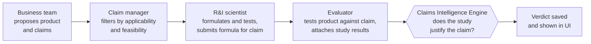

# 1. Business process understanding

## The problem

A cosmetic claim such as *"Reduces wrinkles by 20% in 4 weeks"* is a promise to the consumer, and in the EU it is also a legal statement: it must be backed by adequate, verifiable evidence (see [Research](02-research.md)). A claim that outruns its evidence risks regulatory action, product relabelling or withdrawal, and reputational damage.

Today the check "does this study really support this wording?" is done by people reading study reports. It is slow, depends on who reads it, and the reasoning is rarely recorded in a structured way. The Claims Intelligence Engine gives every claim a fast, consistent, recorded first opinion.

## The flow as described

| Step | Role | What they do | What they need from the system |
|---|---|---|---|
| 1 | Business team | Proposes a product with several candidate claims | A place to register claims |
| 2 | Claim manager | Removes claims that are not applicable or not feasible | A queue of proposed claims and a way to accept or reject |
| 3 | R&I scientist | Formulates the product, runs formulation tests, submits the formula for a claim | To link a formula to a claim |
| 4 | Evaluator | Tests the product against the claim and submits the study report | To attach evidence and get an assessment |
| 5 | **The engine** | Judges whether the evidence justifies the claim | — |

## What this delivery covers

The brief asks for the *core feature*: steps 4–5. A claim and its study evidence go in; a verdict comes out, is stored, and is displayed.

| In scope (built) | Out of scope (see [Roadmap](04-roadmap.md)) |
|---|---|
| Submit product, claim text and study evidence | Business proposal and claim-manager filtering screens |
| LLM assessment: justified yes/no, confidence, reasoning | Formula data and formulation test records |
| Persist claim and every assessment | Users, roles and permissions |
| Re-assess an existing claim with new evidence | PDF study report upload |
| React UI showing the result | Human approval workflow |

## How I read "justifies the claim"

A study justifies a claim only if it supports the claim **as worded**. The engine checks five things, the same ones a human reviewer would:

1. **Endpoint** — did the study measure the effect the claim names (wrinkles, not hydration)?
2. **Magnitude** — does the measured effect reach the number in the claim (20%)?
3. **Timeframe** — was it observed within the claimed period (4 weeks)?
4. **Study quality** — sample size, control or baseline, statistical significance, objective measurement.
5. **Scope** — does the claim reach beyond what was tested (population, usage, formula)?

Missing or vague evidence means **not justified**. The system never gives the benefit of the doubt.

## Assumptions

- **The engine advises; a person decides.** The verdict is decision support for the evaluator and claim manager. It does not approve a claim. The UI says so on every result.
- **Evidence arrives as text.** The evaluator pastes the study summary. File upload is a roadmap item.
- **One claim, many assessments.** Evidence improves over time (a larger study, a longer timeframe), so a claim can be re-assessed. Each assessment is kept, never overwritten, so the history is auditable.
- **A claim's status mirrors its latest assessment**: `PENDING` → `JUSTIFIED` or `NOT_JUSTIFIED`.
- **Single market for now.** The prompt is framed on the EU common criteria. Other markets have different expectations.

## Who benefits

| Who | Benefit |
|---|---|
| Evaluator | Instant first read; gaps in the study are named explicitly |
| Claim manager | Consistent criteria across all claims; faster triage |
| Scientist | Early signal that a claim needs stronger evidence before more lab time is spent |
| Regulatory / legal | A stored record of what evidence was assessed, by which model and prompt, and why |
