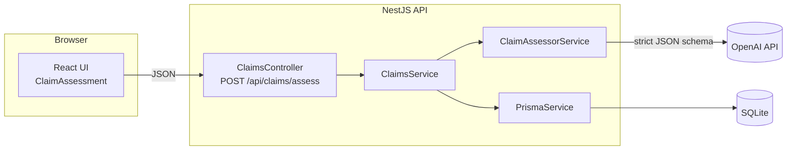
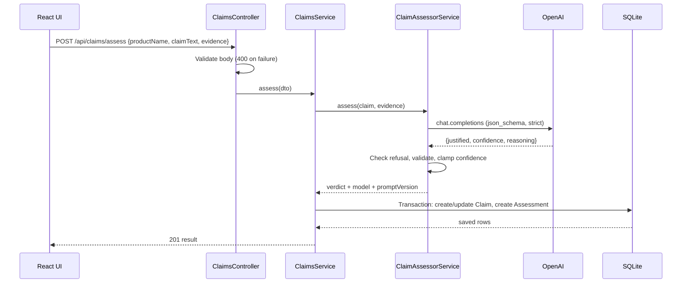

# 3. Technical architecture justification

## Overview

## Request lifecycle

The LLM is called **before** anything is written. If the provider fails, nothing is saved, so there are no half-written claims to clean up.

## Layers and responsibilities

| Layer | File | Responsibility | Does not know about |
|---|---|---|---|
| Controller | `claims/claims.controller.ts` | HTTP route, status code | Database, OpenAI |
| DTO | `claims/dto/assess-claim.dto.ts` | Input validation and limits | Business logic |
| Service | `claims/claims.service.ts` | Orchestration, transaction, response mapping | HTTP, OpenAI request format |
| LLM | `llm/claim-assessor.service.ts` | OpenAI call, output validation, error mapping | Database |
| Prompt | `llm/assessment.prompt.ts` | Prompt text, JSON schema, version | Everything else |
| Data | `prisma/schema.prisma` | Tables and relations | — |

Why this split: the OpenAI-specific code sits behind one method, `assess(input) → verdict`. Changing provider or model touches one file. `ClaimsService` can be unit-tested with no network and no database.

## Key decisions

### Database

| Decision | Reason |
|---|---|
| **Two tables, `Claim` 1—N `Assessment`** | A claim can be assessed many times as evidence improves |
| **Assessments are immutable** | Re-assessing adds a row. The history is an audit trail, which matters in a regulated domain |
| **Evidence stored on `Assessment`** | Each row records exactly what was judged. A later verdict cannot silently change what an earlier one was based on |
| **`model` and `promptVersion` stored** | Any verdict can be traced to the model and prompt that produced it |
| **`status` on `Claim`** | Cheap filtering by state without joining assessments |
| **`status` as string** | SQLite has no native enum in Prisma. Becomes an enum on Postgres |
| **Prisma + SQLite** | One schema file, typed client, zero setup to run. Switching to Postgres is a datasource change |

### Backend

| Decision | Reason |
|---|---|
| **Global `ValidationPipe` with whitelist** | Unknown fields are rejected; bad input never reaches the LLM or DB |
| **Length caps** (claim 500, evidence 20,000 chars) | Bounds token cost and blocks oversized payloads |
| **Structured Outputs, strict schema** | The model is constrained to the exact shape needed |
| **Output re-validated in code** | LLM output is external input. Types checked, confidence clamped to 0–1 |
| **`temperature: 0`** | Same evidence should give the same verdict as far as possible |
| **Claim and evidence wrapped as data** | Reduces prompt-injection risk from user-supplied text |
| **Timeout 30s, 2 retries** | A slow provider cannot hang a request indefinitely |
| **OpenAI client injected by token** | Tests replace it with a fake; no network in the test suite |
| **App boots without an API key** | Endpoint answers 503 with a clear message instead of crashing at start-up |

### Error handling

| Situation | Status | Client sees |
|---|---|---|
| Invalid body | 400 | Field-level messages |
| Unknown `claimId` | 404 | "Claim … not found" |
| No API key configured | 503 | How to fix it |
| Provider error, refusal, malformed output | 502 | Generic message |

Provider error details are logged on the server only. They can contain account or key information and are never returned to the client. A test asserts this.

### Frontend

| Decision | Reason |
|---|---|
| **Three small files** (`api/claims.js`, `ClaimAssessment.jsx`, `AssessmentResult.jsx`) | Network, form state and display are separated; the result card is reusable |
| **Plain `fetch` and `useState`** | One endpoint and one form. A data library would add weight without benefit |
| **Explicit states: idle / loading / error / done** | The user always knows what is happening |
| **Vite dev proxy for `/api`** | Same-origin calls in development; no API URL hard-coded in the UI |
| **"Decision support only" note on every result** | The verdict must not be mistaken for an approval |

## Testing

| Level | Count | Covers |
|---|---|---|
| Unit — LLM service | 13 | Request shape, error mapping, refusal, no leak of provider errors, output validation |
| Unit — claims service | 5 | Create, re-assess, 404, status mapping, no DB write on LLM failure |
| End-to-end | 3 | Real HTTP and real SQLite (isolated test DB), OpenAI faked |

## Known limitations

Stated plainly, because each is a deliberate trade for a one-day scope:

- **Not verified against a live model by the test suite.** OpenAI is faked in tests. Prompt quality needs evaluation against real, human-reviewed claims.
- **Confidence is self-reported by the model, not calibrated.** See [Research, finding 5](02-research.md).
- **No authentication or roles.** Anyone who can reach the API can submit.
- **Synchronous request.** The client waits for the LLM. Fine for one claim; not for batches.
- **No rate limiting or cost tracking.**
- **Text evidence only.** No PDF parsing.
- **SQLite is single-writer.** Right for a demo, not for concurrent production use.
- **No idempotency key.** A double submit creates two claims.

Each of these is addressed in the [Roadmap](04-roadmap.md).
