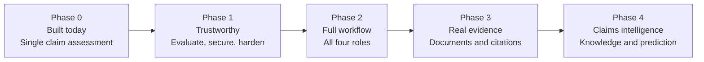

# 4. Product roadmap

How the engine would evolve with ample time and no constraints. Ordered so that each phase makes the next one safe: trust first, then workflow, then scale, then intelligence.

## Phase 1 — Make it trustworthy

The verdict is only useful if people can rely on it. This comes before any new feature.

| Item | Why |
|---|---|
| **Golden evaluation set** — claims with verdicts from expert reviewers; run on every prompt or model change | The only way to know the prompt works, and to change it safely |
| **Confidence calibration** — compare stated confidence with real accuracy; show bands (low / medium / high) instead of a raw percent | Raw LLM confidence is overconfident |
| **Human review step** — reviewer confirms or overrides each verdict; overrides are stored | Keeps a person accountable; overrides become training and evaluation data |
| **Authentication and roles** (SSO) | Required before real data |
| **PostgreSQL**, rate limiting, idempotency keys, cost and latency monitoring | Production basics |
| **Structured reasoning** — per-criterion result (endpoint, magnitude, timeframe, quality, scope) instead of one paragraph | Shows exactly which check failed |

## Phase 2 — Cover the whole business flow

Bring in the three roles upstream of the evaluator.

| Role | Capability |
|---|---|
| Business team | Propose a product with several candidate claims |
| Claim manager | Triage queue; accept or reject on applicability and feasibility, with reasons |
| R&I scientist | Link formula and formulation test results to a claim |
| Evaluator | Attach study results, request assessment, submit report |
| Everyone | Claim status timeline, notifications, comments |

Also: a proper claim state machine (`PROPOSED → ACCEPTED → IN_FORMULATION → IN_EVALUATION → JUSTIFIED / NOT_JUSTIFIED → APPROVED`), and a full audit log of who did what and when.

## Phase 3 — Work with real evidence

| Item | Why |
|---|---|
| **Upload study reports** (PDF, Word, spreadsheets) with text and table extraction | Evaluators work with documents, not pasted text |
| **Citations** — every statement in the reasoning points to the page and passage it came from | Lets a reviewer verify in seconds; exposes hallucination |
| **Background jobs with live progress** | Long documents and batches should not block the UI |
| **Batch assessment** — all claims of a product against one study | Matches how studies are actually run |
| **Multi-market rules** — EU, US, China and others as separate, versioned rule sets | The same claim can be acceptable in one market and not another |
| **Claim rewording suggestions** — "the study supports *15% in 8 weeks*" | Turns a "no" into a usable next step |

## Phase 4 — Claims intelligence

Where the product earns the word *intelligence*.

| Item | Value |
|---|---|
| **Search across past claims and studies** | "Have we substantiated something like this before?" Reuse evidence instead of repeating studies |
| **Feasibility prediction at proposal time** | Tell the business team, before any lab work, how likely a claim is to be substantiated and what study it would need |
| **Study design assistant** | Given a target claim, propose endpoint, method, duration and sample size |
| **Regulatory watch** | Flag approved claims affected when rules or guidance change |
| **Portfolio dashboard** | Claim success rates by category, brand, market; time from proposal to approval |
| **Multi-model verification** | A second model challenges the first; disagreements are routed to a person |

## Cross-cutting, at every phase

- **Data confidentiality.** Formulas and unpublished studies are highly sensitive. Use a private or regional model deployment with no training on submitted data.
- **Human accountability.** The system recommends; a named person approves. This does not change as the model improves.
- **Traceability.** Every verdict keeps its evidence, model, prompt version and reviewer.
- **Measured quality.** No prompt or model change ships without passing the evaluation set.

## What I would do first

If given one more week: the **golden evaluation set** and the **human review step**. Everything else depends on knowing how often the engine is right, and on having a person in the loop when it is not.
